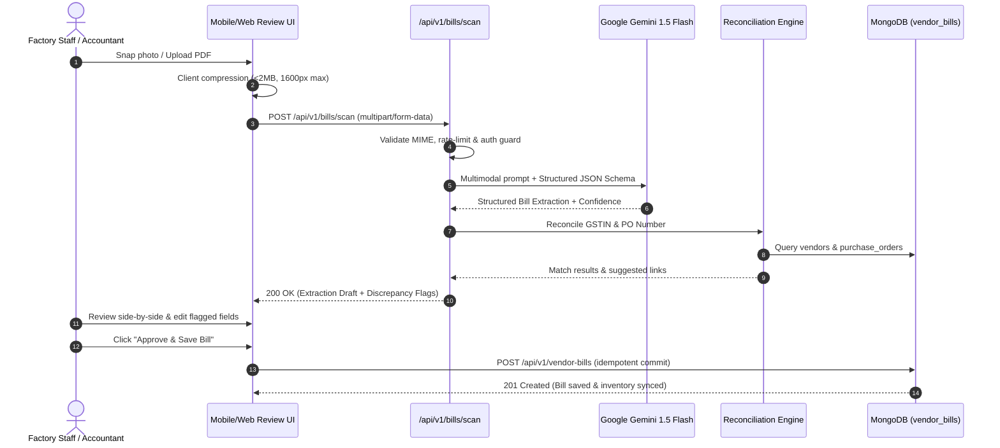
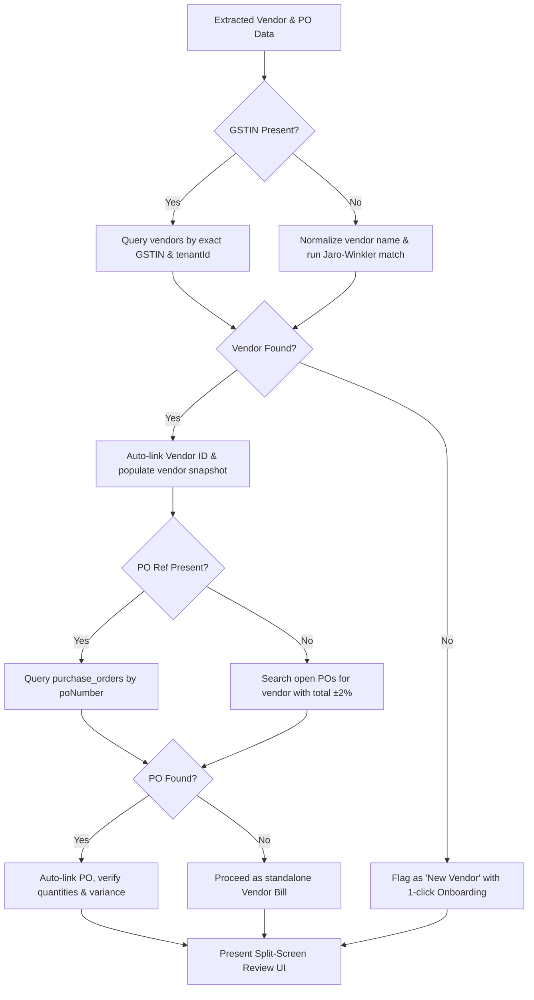

# Feature Specification & Architectural Design: F1 Smart Bill Scan (OCR)

This document specifies the technical design, data contracts, AI extraction pipelines, reconciliation workflows, and operational guardrails for the **F1 Smart Bill Scan** feature. 

> [!IMPORTANT]
> **Implementation Scope**: This is an architectural design specification only. No production feature code is introduced in this phase.

---

## 1. Executive Summary & Objective

Indian MSME manufacturers receive hundreds of physical paper invoices and PDF bills monthly from raw material suppliers, packaging vendors, and transport providers. Manual entry into IND-Manager leads to human error, delayed GST input tax credit (ITC) reconciliation, and inventory discrepancy.

**Feature Goal**: Enable users to capture a photo of a vendor paper bill via smartphone camera or upload a PDF bill on desktop, automatically extract all tax, vendor, line item, and payment data via Google Gemini Multimodal Vision API, auto-match against existing vendors and Purchase Orders (POs), and present a high-confidence review interface before committing to `vendor_bills`.

---

## 2. End-to-End System Architecture



---

## 3. Structured Extraction Schema (Gemini Structured Outputs)

The extraction engine leverages Gemini 1.5 Flash's native JSON Schema structured output mode to guarantee deterministic JSON response typing without hallucinated keys.

```typescript
export interface ExtractedBillData {
  // Vendor Identification
  vendor: {
    name: string;
    gstin?: string;
    pan?: string;
    phone?: string;
    email?: string;
    address?: string;
  };

  // Bill Metadata
  billNumber: string;
  billDate: string; // ISO 8601 (YYYY-MM-DD)
  dueDate?: string; // ISO 8601 (YYYY-MM-DD)
  poReferenceNumber?: string;
  challanNumber?: string;

  // Line Items
  items: Array<{
    description: string;
    hsnCode?: string;
    quantity: number;
    unit: string; // kg, m, pcs, nos, ltr, etc.
    unitPrice: number;
    discountAmount?: number;
    taxableAmount: number;
    gstRate: number; // 0, 5, 12, 18, 28
    cgstAmount?: number;
    sgstAmount?: number;
    igstAmount?: number;
    totalAmount: number;
  }>;

  // Financial Totals
  financials: {
    subtotal: number;
    totalDiscount?: number;
    totalCgst?: number;
    totalSgst?: number;
    totalIgst?: number;
    roundOff?: number;
    totalAmount: number;
  };

  // Payment & Bank Details (for auto-reconciliation)
  bankDetails?: {
    accountNumber?: string;
    ifscCode?: string;
    bankName?: string;
    upiId?: string;
  };

  // Model Metadata
  confidence: {
    overall: number; // 0.0 - 1.0
    fieldScores: Record<string, number>;
    warnings: string[];
  };
}
```

---

## 4. Verification, Validation & Integrity Rules

Extracted data undergoes programmatic deterministic validation before reaching the review screen:

### A. Mathematical Consistency Checks
1. **Line Item Sum**: $\sum (\text{item.taxableAmount}) \equiv \text{subtotal} \pm 1.00$ (tolerance for rounding).
2. **Tax Consistency**:
   - If Inter-State (Vendor state $\neq$ Tenant state): $\text{CGST} = 0, \text{SGST} = 0, \text{IGST} > 0$.
   - If Intra-State (Vendor state $=$ Tenant state): $\text{CGST} = \text{SGST} = \frac{\text{IGST}}{2}$.
3. **Grand Total Balance**: $\text{subtotal} + \text{totalCgst} + \text{totalSgst} + \text{totalIgst} + \text{roundOff} \equiv \text{totalAmount} \pm 1.00$.

### B. Format & Checksum Validations
- **GSTIN Format Check**: Matches regex `^[0-9]{2}[A-Z]{5}[0-9]{4}[A-Z]{1}[1-9A-Z]{1}Z[0-9A-Z]{1}$`.
- **PAN Extraction**: Digits 3 through 12 of a valid GSTIN automatically extract the vendor's 10-digit PAN.
- **Date Plausibility**: $\text{billDate} \le \text{Today} + 1\text{ day}$ and $\text{billDate} \ge \text{Today} - 365\text{ days}$.

---

## 5. Vendor & Purchase Order (PO) Matching Algorithm



---

## 6. Security, Rate Limiting & Operational Cost Controls

### A. File Upload & Ingestion Security
- **MIME Sniffing**: Inspect Magic Bytes (not file extension). Allowed: `image/jpeg` (`FF D8 FF`), `image/png` (`89 50 4E 47`), `application/pdf` (`25 50 44 46`).
- **File Size Caps**: Images capped at 5MB; PDFs capped at 10MB (first 3 pages processed).
- **Execution Sandboxing**: Image processing and PDF-to-image extraction executed in ephemeral memory buffers without saving raw binary to local disk.

### B. Rate Limiting & Tier Quotas
Implemented via Redis / In-Memory token bucket:
- **Starter Tier**: 25 scans / month
- **Pro Tier**: 500 scans / month
- **Enterprise Tier**: Unlimited
- **Burst Defense**: Max 5 scans per minute per user to prevent API flooding.

### C. Cost Modeling (Google Gemini 1.5 Flash)
- Average prompt + image tokens per invoice: ~1,800 tokens.
- Output JSON tokens: ~500 tokens.
- **Cost per invoice**: $\approx \$0.00015$ (less than ₹0.015 per scan).
- A factory processing 500 bills per month incurs an AI compute cost of **~₹7.50 / month**, delivering 99.8% margin efficiency on SaaS subscriptions.

---

## 7. Fallback & Failure Resilience

1. **AI API Outage / Timeout**: If Gemini fails or times out after 12 seconds, the client UI gracefully falls back to split-screen manual entry mode:
   - Scanned image remains pinned in the left pane.
   - Blank vendor bill form opens in the right pane for manual typing with keyboard shortcuts (`Tab` to jump fields).
2. **Low-Confidence Extraction (<0.70)**: Highlighting low-confidence fields in yellow (`border-amber-400 bg-amber-50/20`) requiring accountant review before the "Approve" button activates.

---

## 8. Open Architectural Questions for Alignment

Before commencing implementation in future phases, the following design decisions require product confirmation:

1. **Scanned Image Retention**:
   - *Option A (Default)*: Upload raw bill image to encrypted S3 / GCS bucket and store URL on `vendor_bill.attachmentUrl` for permanent audit trail.
   - *Option B (Ephemeral)*: Discard raw image after 30 days once bill is approved and reconciled with GST portal.
2. **Automatic Inventory Sync**:
   - *Option A*: Approving a bill linked to a Purchase Order automatically increments inventory quantities for the PO's line items.
   - *Option B (Recommended)*: Bill approval records the financial liability only; inventory stock is incremented strictly via the existing "Mark as Received" / Delivery Challan flow to prevent double-counting.
3. **New Vendor Creation Policy**:
   - *Option A*: Auto-create new vendor record silently if GSTIN does not exist.
   - *Option B (Recommended)*: Require accountant confirmation click to onboard the new vendor to avoid duplicate vendors with slight naming variations.
